# Secure Login Authentication System with Two-Factor Authentication and Role-Based Access

**Student name:** Addo Eric  
**Student number:** PUIT24210065  
**Institution:** Pentecost University  
**Faculty:** FESAC  
**Course:** Information Technology  
**Date:** October 2026

---

## 1. Introduction and objectives

Almost every application that stores personal information needs to answer two questions: *who is this user?* and
*what are they allowed to do?* This project builds a small but realistic authentication system that answers both
questions and protects the passwords it stores.

The objectives, taken from the assignment brief, were to implement:

1. **User identification and registration**: users create an account and later prove who they are.
2. **Two-factor authentication (2FA)**: a password alone is not enough; a one-time code is also required.
3. **Role-based authorization**: what a user may do depends on a role (`admin` or `user`) that the server enforces.
4. **Salt and pepper**: passwords are stored using a salted hash combined with a secret server-side pepper.

The system has a mobile and web interface built with Expo, and a PHP and MySQL backend that runs locally on XAMPP or
Laragon. The same code is also deployed online at **https://puit24210065.vercel.app**, so that it can be tried from a
public link.

## 2. Technologies used

| Layer | Technology | Why it was chosen |
| --- | --- | --- |
| Interface | Expo, React Native, TypeScript | One code base for Android, iOS and the browser, as required by the brief. |
| Navigation | Expo Router | File-based routing; the same routes work on phone and web. |
| Token storage (phone) | Expo SecureStore | Uses the iOS Keychain and Android Keystore. |
| API | PHP 8.1+ (no framework, no Composer) | Runs on any XAMPP or Laragon installation without extra downloads. |
| Database | MySQL / MariaDB with PDO | Prepared statements, foreign keys, unique indexes. |
| Password hashing | `password_hash()` / `password_verify()`, Argon2id (bcrypt fallback) | Built into PHP, adaptive and salted. |
| Email | A small SMTP client written for the project | Sends the one-time code; no external library needed. |
| Online hosting | Vercel (static site + `vercel-php` functions) | Serves the Expo web build and runs the same PHP API under `/api`, over HTTPS. |
| Online database | Aiven MySQL 8.4 | Managed MySQL reachable from Vercel, with an encrypted (TLS) connection. |
| Online email | Gmail SMTP with an App Password | Delivers the one-time codes on the public site. |

Development tools: Visual Studio Code, Git and GitHub, and the AI coding assistant Claude Opus 5.5 (Anthropic), which was
used to help write the code, tests and documentation.

## 3. System architecture

```
 Phone (Expo Go)  ─┐                                   ┌─ users
                   ├── HTTPS/JSON ──►  PHP REST API ──►├─ otp_challenges   (MySQL)
 Browser (Expo web)┘   (Bearer token   public/index.php├─ sessions
                        or HttpOnly    └ Kernel        └─ rate_limits
                        cookie)          └ AuthService
```

* **Client.** The Expo app has three signed-out screens (sign in, register, verify code) and three signed-in screens
  (dashboard, profile, administration). A route guard sends signed-out users to the sign-in screen, but this is only for
  convenience; the real checks are made by the server.
* **API.** `public/index.php` is the only entry point. The `Kernel` class handles routing, CORS, CSRF checks, session
  lookup and role checks, and returns response objects, which makes the whole API testable without a web server.
  `AuthService` contains the business logic (registration, password check, one-time code, sessions). Other small classes
  handle passwords, tokens, rate limiting, validation and email.
* **Database.** All access uses PDO prepared statements. Timestamps are generated by the application in UTC so behaviour
  does not depend on the database server's time zone.
* **Configuration.** Secrets (pepper, database password, SMTP password) live only in `backend/.env` on the server. The
  server refuses to start if the configuration is unsafe, for example if the pepper is missing, CORS is a wildcard, or the
  development one-time-code mode is enabled in production.
* **Online version.** On Vercel, `api/index.php` simply includes `backend/public/index.php`, so the public site runs the
  same PHP code. The website and the API share one domain, so the session cookie stays first-party. Settings come from
  Vercel's encrypted environment variables instead of `.env`, the database is Aiven MySQL (TLS verified against Aiven's CA
  certificate), and codes are emailed through Gmail.

## 4. Database design

| Table | Purpose | Important columns and constraints |
| --- | --- | --- |
| `users` | One row per account | `email` (unique), `password_hash`, `role` (`ENUM('user','admin')`, default `user`), `created_at`, `last_login_at` |
| `otp_challenges` | A pending or used second-factor challenge | `challenge_hash` (unique), `otp_hash`, `attempts`, `expires_at`, `used_at`; foreign key to `users` with `ON DELETE CASCADE` |
| `sessions` | Login sessions | `token_hash` (unique), `expires_at`, `revoked_at`; foreign key to `users` |
| `rate_limits` | Counters for abuse prevention | `bucket` (primary key, a hash), `hits`, `window_start` |

Design decisions:

* The `email` column is unique, so the database itself rejects duplicates even if two requests race.
* Neither the one-time code, the challenge identifier, nor the session token is stored in readable form. Only hashes are
  stored (see sections 6 and 7).
* Indexes exist on foreign keys and on expiry columns, which are used when looking up sessions and cleaning old rows.
* The complete script is `backend/database/schema.sql`.

## 5. User identification and registration

**Registration** (`POST /api/register`). The client validates the form first (name length, email format, password rules,
matching confirmation) to give instant feedback. The server then validates the same rules again, because client checks
can be bypassed. The password must be 12 to 128 characters long, contain at least one letter and one digit, must not be a
very common password, and must not equal the email address. The email is converted to lower case; if an account with
that email already exists the server answers `409`. The role of a new account is always `user`; the request body cannot
choose a role.

**Sign-in, step 1** (`POST /api/login`). The server looks up the account by email and verifies the password. For an
unknown email it still performs a hashing operation, so that response time does not reveal whether an account exists. A
wrong password and an unknown email produce exactly the same response (`401`, "Invalid email or password."). At this
point the user is **not** signed in: no session exists until the second factor is verified.

## 6. Two-factor authentication

After a correct password the server:

1. generates a six-digit code with `random_int()`, PHP's cryptographically secure generator;
2. creates a random 256-bit *challenge identifier* and returns it to the app;
3. stores only a keyed hash of the code (HMAC-SHA256, keyed with a secret derived from the pepper) and a hash of the
   challenge identifier;
4. delivers the code by email through the SMTP server configured in `.env`.

**Sign-in, step 2** (`POST /api/verify-otp`). The app sends the challenge identifier and the code. The server enforces:

* **Expiry**: a code is valid for five minutes.
* **Attempt limit**: five wrong guesses lock the code. The attempt counter is increased with a single atomic SQL
  statement *before* the comparison, so parallel requests cannot gain extra guesses.
* **Single use**: the code is marked as used with `UPDATE ... WHERE used_at IS NULL`; only the request that changes the row
  succeeds, so a code cannot be replayed.
* **Replacement**: asking for a new code, or signing in again, invalidates the previous code.
* **Account-level limit**: wrong guesses are also counted per account across challenges, so repeatedly starting a new
  sign-in does not reset the guess budget.

**Development mode.** To demonstrate the system without an email server, `OTP_DELIVERY=dev` makes the API return the
code in its response, and the app shows it in a clearly labelled "Development mode" box. The server refuses to start with
this setting when `APP_ENV=production`, so the code can never be exposed by a production deployment. The setting is off
unless it is written into `.env`.

## 7. Sessions

When the code is correct the server creates a random 256-bit session token and stores its **SHA-256 hash**, together with
an expiry time (8 hours by default). If the database were leaked, the stored values could not be used as sessions.

* **Native app:** the token is returned once and kept in **Expo SecureStore** (Keychain / Keystore). It is sent as a
  `Bearer` header.
* **Web:** the token is **never given to JavaScript**. It is sent as an `HttpOnly` cookie (`Secure` when configured, with
  `SameSite`). `localStorage` is deliberately not used, because any script on the page could read it. Because browsers
  attach cookies automatically, the server also protects cookie-based state-changing requests against cross-site request
  forgery: logout requires an allowed `Origin` header and a custom `X-Client-Type` header.
* **Logout** sets `revoked_at` in the database, so the token stops working immediately, even if someone copied it.

## 8. Role-based authorization

There are two roles, `user` and `admin`. For every protected request the server finds the session, loads the user **from
the database** and checks the role. The interface hides the Admin menu link from ordinary users, but that is only for
usability: the endpoint `GET /api/admin/users` returns `403 Forbidden` to a normal user and `401` to a visitor without a
session, whatever the client code or request contains. Changing a role in the database takes effect on the next request.

Public registration cannot create administrators. The first administrator is created on the server by registering
normally and then running `php bin/set-role.php you@example.com admin`; only someone with access to the server can do this.
Alternatively, the server setting `ADMIN_EMAILS` lists administrator email addresses. A listed account is promoted only
after a successful login with both the password and the emailed code, which proves the person controls that inbox. The
name a user types and the act of registering never grant the admin role. The online version uses this setting.

## 9. Salt and pepper password protection

* **Salt.** `password_hash()` generates a unique random salt for every password and stores it inside the hash string. Two
  users with the same password therefore get different hashes, and precomputed (rainbow) tables are useless.
* **Pepper.** A secret value, at least 32 characters, is kept in the server configuration, never in the database or the app.
  Before hashing, the password is passed through `HMAC-SHA256` keyed with the pepper, and the result is given to
  `password_hash()`. An attacker who steals only the database cannot even start guessing passwords offline without the
  pepper. This pre-hashing step also avoids bcrypt's 72-byte limit.
* **Algorithm.** Argon2id is used when PHP supports it, otherwise bcrypt with cost 12. `password_needs_rehash()` upgrades
  old hashes at the next successful login.
* **Plaintext** passwords are never stored, logged or returned by the API.

The cost of the pepper is that it cannot be rotated without forcing password resets, because it is part of every hash.
This is listed under limitations.

## 10. Other protections

* **Rate limiting** (stored in MySQL): 8 failed sign-ins per email and 30 requests per IP per 15 minutes; 30 code
  attempts per IP; at most 10 registrations per hour per IP; a 30-second cooldown between code requests. Responses are
  `429` with a `Retry-After` header.
* **Prepared statements** everywhere, so input cannot change the meaning of a query.
* **CORS** allows only the exact origins listed in `.env`, never `*`, because cookies are involved.
* **Safe errors.** Authentication failures are generic. Unexpected errors return a generic message while details go to the
  server log. Misconfiguration returns `500`/`503` without naming settings or values.
* **Response headers**: `Cache-Control: no-store`, `X-Content-Type-Options`, a restrictive
  `Content-Security-Policy`, and `Strict-Transport-Security` in production.

## 11. Implementation details

| Area | Where |
| --- | --- |
| Entry point and routing, CORS, CSRF, role guard | `backend/src/Http/Kernel.php`, `backend/public/index.php` |
| Registration, login, OTP, sessions | `backend/src/Services/AuthService.php` |
| Salt and pepper | `backend/src/Security/Passwords.php` |
| Secure random values | `backend/src/Security/Tokens.php` |
| Rate limiting | `backend/src/Security/RateLimiter.php` |
| Email (SMTP) and development delivery | `backend/src/Mail/` |
| Validation | `backend/src/Validation/Validator.php`, `mobile/src/lib/validation.ts` |
| Configuration safety checks | `backend/src/Config.php` |
| Database schema | `backend/database/schema.sql` |
| Command-line tools | `backend/bin/setup-db.php`, `set-role.php`, `generate-secret.php` |
| App screens | `mobile/app/` |
| API client, session state, secure storage | `mobile/src/lib/api.ts`, `auth.tsx`, `storage.ts` |

The interface is deliberately simple: a header bar with the application name and (when logged in) the menu links
Dashboard, Profile, Admin (administrators only) and Logout, with the page content below it. Forms are a single column with
a maximum width, so the same layout works on a phone and in a desktop browser. The admin user list is a plain table that
scrolls sideways on narrow screens. Forms show a loading state on the button, field-level errors and readable messages.

## 12. Testing

### 12.1 Automated backend tests (PHP)

`backend/tests/run.php` contains 63 tests that call the API kernel directly against a separate test database
(`login_auth_test`). They cover every item required by the brief:

| Requirement | Test file |
| --- | --- |
| Registration succeeds; duplicates (including different letter case) are rejected; validation; SQL-injection input | `registration.php` |
| Passwords are stored as salted, peppered hashes (plaintext absent, wrong pepper fails, same password gives different hashes) | `registration.php` |
| Correct and incorrect password; identical generic errors for unknown email | `login_and_otp.php` |
| OTP success, wrong code, attempt limit, expiry (exactly 300 s), reuse, replacement, resend, delivery failure; hashes only in the database | `login_and_otp.php` |
| Session creation, invalid and expired sessions, logout and revocation, web cookie flow and CSRF checks | `login_and_otp.php` |
| Admin can list users; normal user gets 403; anonymous gets 401; role comes from the database; no hashes in output | `authorization.php` |
| CORS (allowed origin, rejected origin, never `*`), 404/405/400/413/415, security headers, rate limits (account, IP, registration, OTP guessing) | `http_and_abuse.php` |
| Configuration errors handled safely (missing/short/placeholder pepper, dev OTP in production, wildcard CORS, insecure cookies, bad SMTP, database down) and no dev OTP in production responses | `configuration.php` |

**How the tests were run.** On the development computer, Windows Smart App Control blocked `php.exe`, and no MySQL
server could be started. The suite was therefore run with `tools/wasm-runner` (`npm test`): PHP 8.3 compiled to
WebAssembly, running inside Node.js, with an in-memory **SQLite** database instead of MySQL. A small translation layer
(`tools/wasm-runner/compat.php`) rewrites the few MySQL-only statements (`ON DUPLICATE KEY UPDATE`, `TRUNCATE`,
`SET FOREIGN_KEY_CHECKS`, one `DATE_ADD` in a test). The application code itself is not changed. Because this PHP build has
no Argon2 support, the bcrypt fallback was the algorithm exercised.

Result:

```
63 passed, 0 failed (894 assertions)
```

To check that the tests really detect faults, three bugs were deliberately introduced in a copy of the code, one at a
time. Each was caught: removing the admin role check failed 2 authorization tests; making codes valid for 99,999 seconds
failed the five-minute expiry test; and no longer marking codes as used failed 4 OTP tests (including "a code can be used
only once").

**Not yet verified against MySQL.** The MySQL schema (`database/schema.sql`), the MySQL form of the rate-limit query and
the duplicate-key error code (1062) were not exercised by this run. The schema and the rate-limit query were later used on
the online MySQL database (section 12.4), but the test suite itself has not run against MySQL. On a computer where XAMPP or
Laragon works, run:

```
cd backend
php tests/run.php
```

and add the output here:

```
(paste the output of php tests/run.php here, including the final "N passed, M failed" line)
```

### 12.2 Client checks that were actually run

| Check | Command | Result |
| --- | --- | --- |
| TypeScript type check (strict mode) | `npm run typecheck` in `mobile/` | Completed with no errors |
| Client validation unit tests | `npm test` in `mobile/` | 6 tests, 6 passed, 0 failed |
| Production web build | `npx expo export --platform web` | Succeeded; output in `mobile/dist` (one JavaScript bundle, about 1.1 MB, and `index.html`) |
| Secrets in build output | search of the built JavaScript for `DB_PASS`, `APP_PEPPER`, `SMTP_PASS` | None found |

### 12.3 End-to-end tests over HTTP and in a browser

The unit tests above call the API classes directly, so they skip the code that reads real HTTP requests and writes real
responses (headers, cookies, `public/index.php`). Two further checks covered that path, using the real PHP API served by
`tools/wasm-runner` (`npm run api`), again with SQLite instead of MySQL:

* **HTTP checks (26 passed, 0 failed):** register, duplicate and invalid registration, wrong password, login with
  code, wrong code with attempts remaining, correct code, code reuse refused, bearer-token session, normal user refused
  on the admin route (403), anonymous refused (401), logout and revocation, CORS for allowed and unknown origins, a
  browser sign-in from a disallowed origin refused, the `HttpOnly; SameSite=Lax` session cookie, promotion with the real
  `bin/set-role.php`, the admin user list without password hashes, and cookie logout refused without the CSRF headers.
* **Browser test (60 passed, 0 failed):** the web build was opened in a headless Edge browser and driven through a
  script in three sessions (desktop standard user, phone-sized administrator, desktop administrator) against the real
  PHP API.

While these were being set up, a database-locking error appeared. It was caused by the test environment (SQLite file
locks on a mounted Windows folder), not by the application, and was fixed in the runner. Some early runs also failed
one step each because the script checked the page before the server had finished hashing the password; the script was
changed to wait for each result. No bugs were found in the PHP application code.

Earlier, before the backend could be run, the same browser script was used against a small mock API to develop the
interface. The browser checks were: redirect to sign-in when signed out; empty and weak inputs rejected on the client;
registration; generic error for a wrong password; moving to the code screen; wrong then correct code; dashboard and role
display; session survives a reload through the cookie; no token in `localStorage` or `sessionStorage`; the session cookie is
not readable from JavaScript; profile page; the administration page listing users for an administrator and showing
"Access denied (403)" for a normal user; sign-out and redirect. Two bugs found by this process (a confusing error when the
API address was wrong, and a spurious "session ended" message at start-up) were fixed.

### 12.4 Tests of the online version (real MySQL and real email)

The deployed site at https://puit24210065.vercel.app was tested on 11 October 2026.

* **Database setup:** `backend/database/schema.sql` was run unchanged on Aiven MySQL 8.4.11 over a verified TLS
  connection and created the four tables. This is the first run of the project against real MySQL.
* **Automated live checks (17 passed, 0 failed):** health check reaching the database; `Strict-Transport-Security` and
  `no-store` headers; registration (new account gets the `user` role); duplicate email in different letter case refused
  (409); invalid input refused (422); wrong password refused with the generic message (this also exercises the MySQL
  form of the rate-limit query); correct password sends the code **by email**, and the response does not contain the
  code; masked email hint; a wrong code is refused with 4 attempts left; no session without the code (401); the admin
  route refused without a session (401); CORS allows only the site's own origin; finishing a sign-in from another
  origin is refused (403).
* **Manual check:** an account was registered on the public site with a personal Gmail address, the emailed code arrived
  and was entered, and the account was signed in. That account was then made an administrator directly in the database
  (the online equivalent of `bin/set-role.php`).
* **Problem found and fixed:** the first live run failed to send email (SMTP error 535, "username and password not
  accepted") because the App Password had been created in a different Google account from the sender address. The
  application handled it safely: it answered 503 and kept no code. Using the matching account fixed it.

### 12.5 Screenshots

Figures 1–10 were captured from the web version of the app running against the real PHP API on the local computer
(`tools/wasm-runner`, development mode, so the code is shown on screen instead of being emailed). Figure 11 is from the
online MySQL database.

<p><b>Figure 1.</b> Login screen.<br>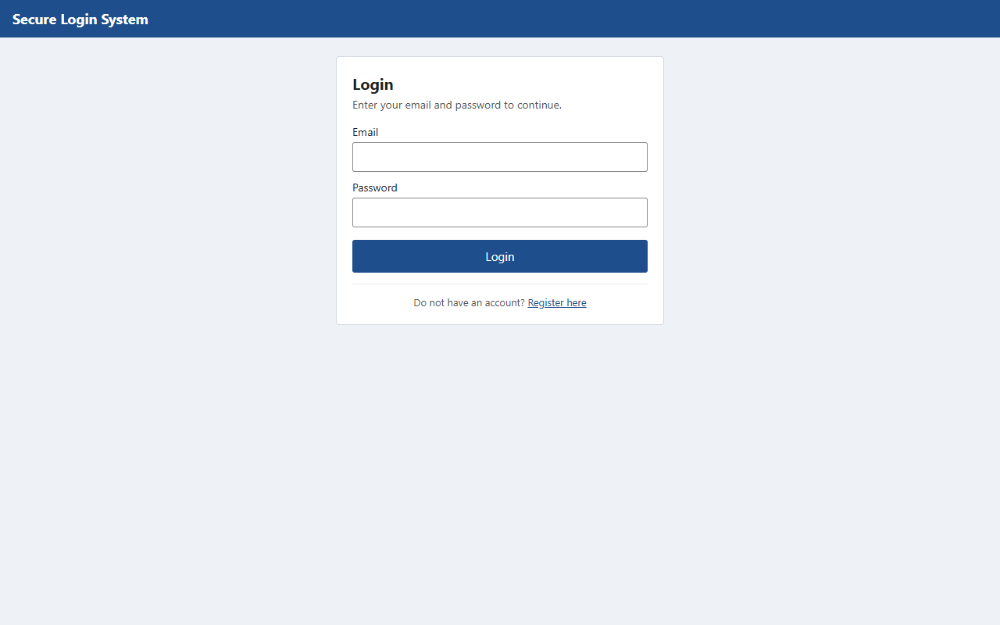</p>

<p><b>Figure 2.</b> Registration with client-side validation errors.<br>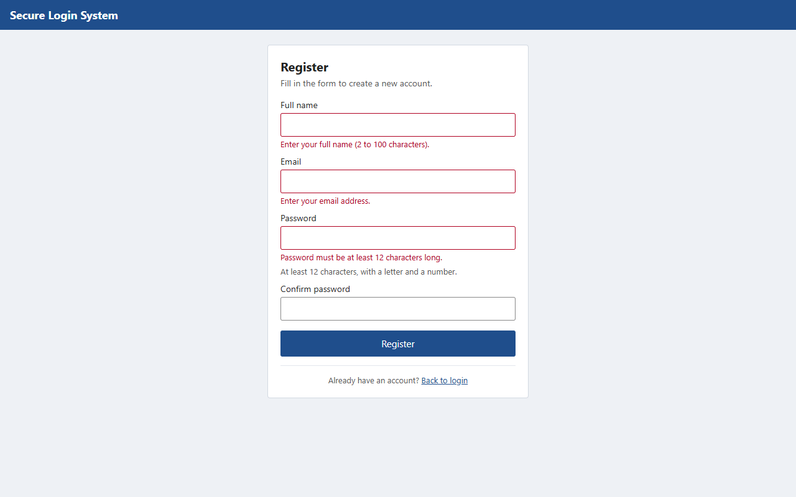</p>

<p><b>Figure 3.</b> After a successful registration the user is returned to the login screen with a message.<br>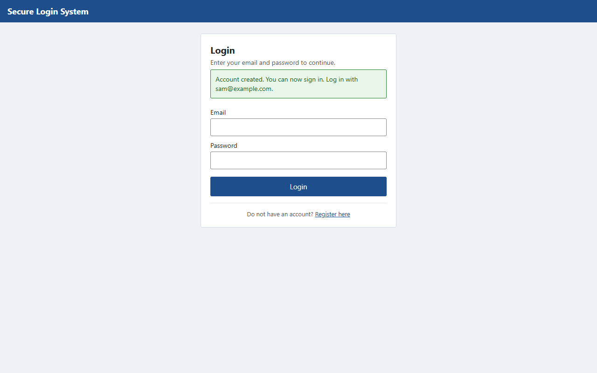</p>

<p><b>Figure 4.</b> Two-factor step after the correct password. In development mode the code is shown in the yellow box;
online it is emailed.<br>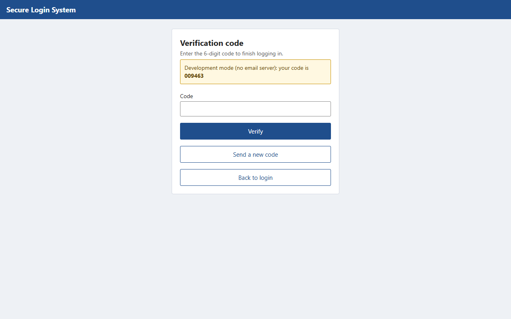</p>

<p><b>Figure 5.</b> A wrong code is refused (the server also counts the attempt).<br>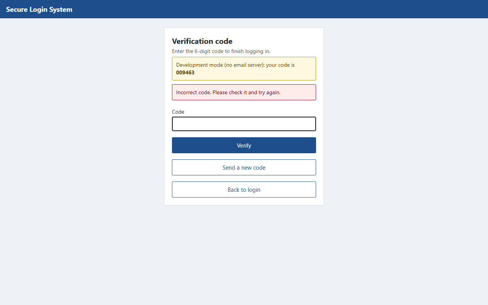</p>

<p><b>Figure 6.</b> Dashboard of a standard user after password + code.<br>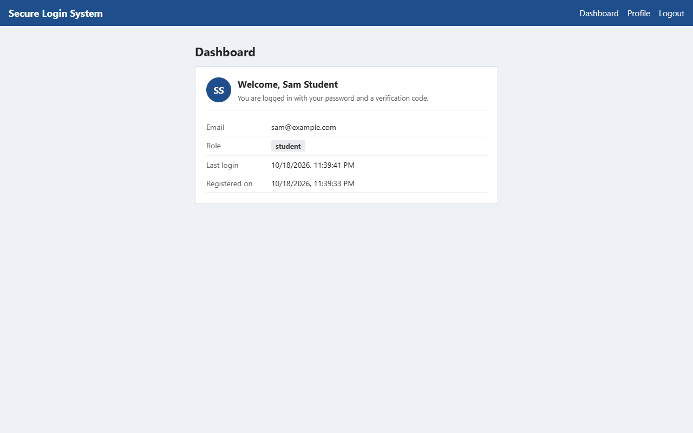</p>

<p><b>Figure 7.</b> Profile page showing the role.<br>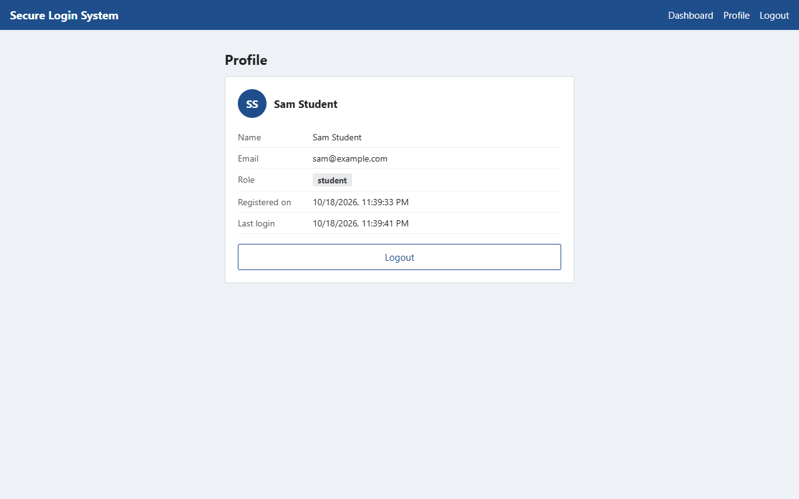</p>

<p><b>Figure 8.</b> A standard user who opens the admin page by typing its address is refused by the server (403).<br>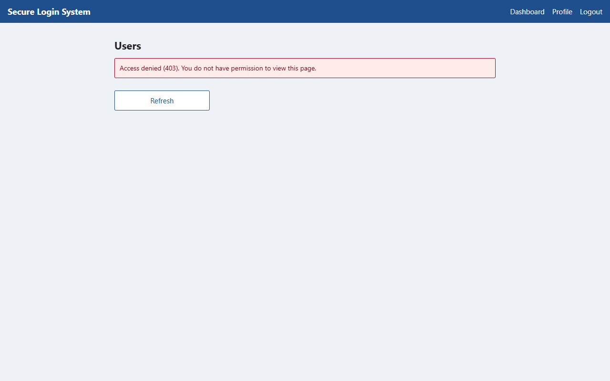</p>

<p><b>Figure 9.</b> The admin page for an administrator, listing registered users (no password data is sent).<br>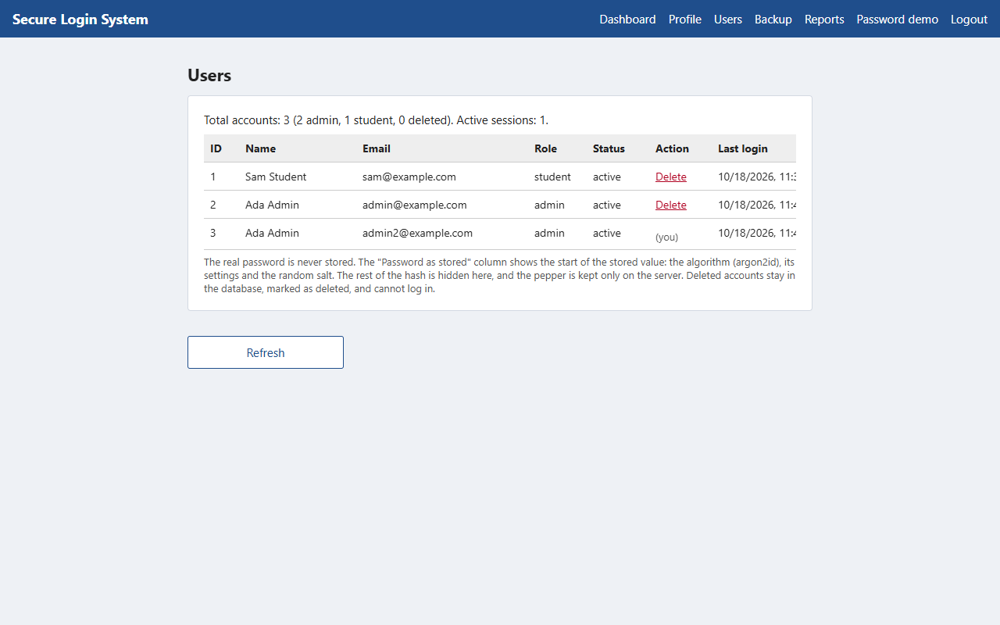</p>

<p><b>Figure 10.</b> The dashboard at phone width.<br>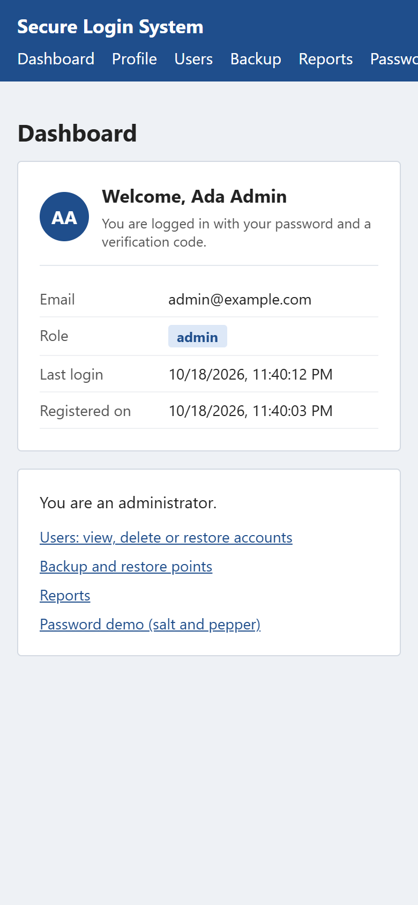</p>

<p><b>Figure 11.</b> The <code>users</code> table in the online MySQL database. The password column contains only the
Argon2id hash produced by <code>password_hash()</code>; the salt is inside the hash and the pepper is not stored.<br>
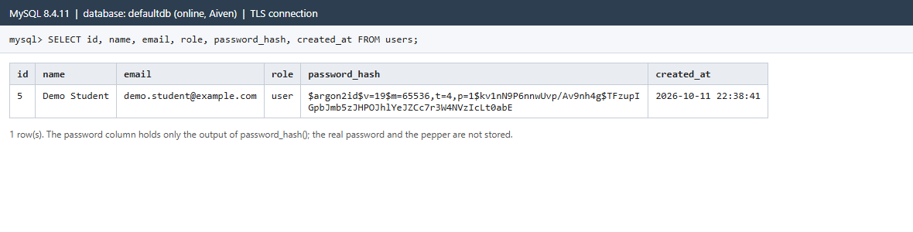</p>

Still to add from a local XAMPP or Laragon run: the terminal output of `php tests/run.php`, and the app running in Expo
Go on a phone.

## 13. Limitations and future improvements

* The backend tests were run with PHP in WebAssembly against SQLite, not yet against MySQL (section 12.1).
* Email delivery through SMTP is implemented but has not been tested against a live mail server.
* The pepper is a single secret; rotating it would require a re-hash migration (for example storing a pepper version
  with each hash) or forced password resets.
* Account lockout is per email, so an attacker can temporarily lock a victim's login by sending wrong passwords. A
  CAPTCHA or progressive delays would reduce this.
* Registration reveals whether an email is already registered (needed for a clear error message). Email verification would
  avoid this.
* No password reset, email verification or "remember this device" feature; sessions are fixed-length.
* Roles are changed only from the command line; there is no administrator interface for changing roles.
* The second factor is an emailed code, which is only as secure as the mailbox. Authenticator apps (TOTP) or WebAuthn
  passkeys are stronger.
* Rate limits are stored in MySQL and keyed by IP address, which can be inaccurate behind shared networks or proxies.
* The online version depends on three free or trial services (Vercel, Aiven, Gmail). Gmail limits sending to about 500
  emails a day, codes can land in spam folders, and the first request after a quiet period can be slow while Vercel
  starts the PHP function.

## 14. Conclusion

The project implements the four required elements: users are identified through validated registration and a password
check; a second factor (a single-use, expiring, attempt-limited one-time code) is required before a session is created;
authorization depends on a role that the server reads from the database on every protected request; and passwords are
protected with a per-password salt plus a server-side pepper. Sessions are random, stored only as hashes, expire and can
be revoked, and the web version avoids storing tokens where scripts can read them.

The interface was built, type-checked, unit-tested and compiled for the web. The backend's 63 tests pass, and the whole
system was tested end to end over HTTP and in a browser with the real PHP code, using SQLite in place of MySQL. The
online version was then tested against real MySQL with real emailed codes, and sign-in works there. The full test suite
has still to be run against a local XAMPP or Laragon MySQL.

## 15. Instructions for running the application

See `README.md` for the full step-by-step guide. In short, on Windows with XAMPP and Node.js installed:

```
# 1. start MySQL in the XAMPP Control Panel
cd backend
copy .env.example .env          # then put the output of  php bin/generate-secret.php  after APP_PEPPER=
php bin/setup-db.php
php tests/run.php               # backend tests
php -S localhost:8000 -t public public/index.php

# in a second terminal
cd mobile
npm install
npm test
npx expo start                  # press w for the browser
```

To make an administrator: register in the app, then `php bin/set-role.php you@example.com admin`.
The online version is at https://puit24210065.vercel.app. How it is set up (Vercel, Aiven MySQL, Gmail) is described in
`docs/DEPLOYMENT.md`, section 0.
