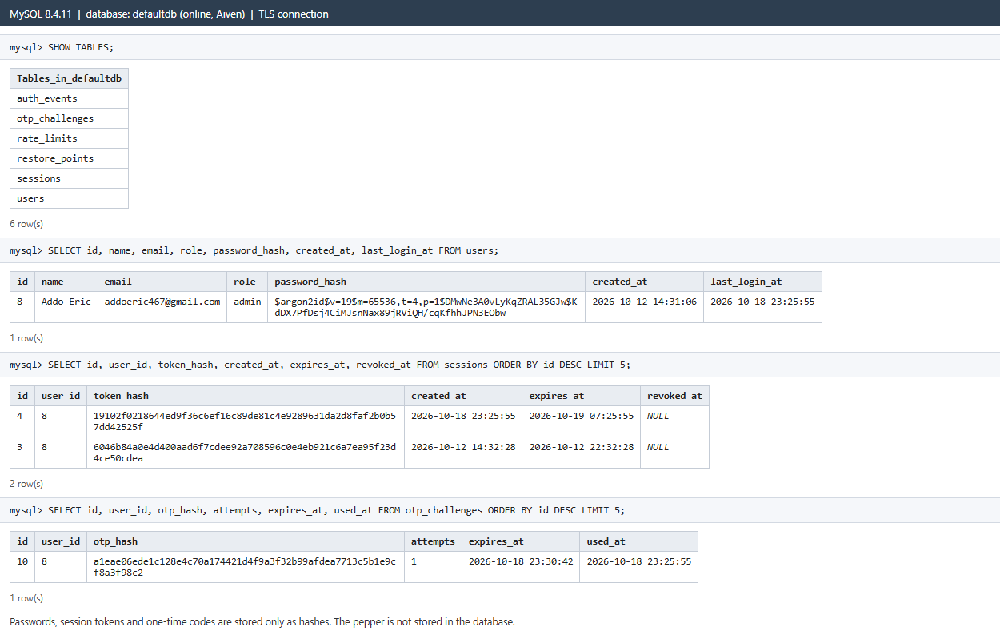

# Database

The online version uses a **MySQL 8.4** database hosted on **Aiven**, connected over an encrypted (TLS) connection.
The local version uses MySQL from XAMPP or Laragon. Both use the same tables, created by
[`backend/database/schema.sql`](../backend/database/schema.sql).

## Tables

| Table | What it stores | What is hashed |
| --- | --- | --- |
| `users` | name, email, role (`student` / `admin`), dates, `deleted_at` (accounts are marked as deleted, not erased) | the password: only the `password_hash()` result (Argon2id, salt inside). The pepper is **not** stored. |
| `otp_challenges` | each 6-digit login code, attempts, expiry, when it was used | the code (HMAC), and the challenge id (SHA-256) |
| `sessions` | each login session, expiry, when it was logged out | the session token (SHA-256) |
| `rate_limits` | counters that stop password guessing | the counter key (SHA-256) |
| `auth_events` | security events for the admin reports (logins, failed logins, admin actions) | nothing secret is logged: no passwords or codes; unknown emails are masked |
| `restore_points` | saved configuration: each account's role and deleted status | — |

A database created before October 2026 is upgraded with
[`backend/database/migrations/002_student_role_backup_reports.sql`](../backend/database/migrations/002_student_role_backup_reports.sql).

## Backup and restore

* **Full backup** (admin Backup page): an SQL file with every table and row. Restoring it (phpMyAdmin → Import) replaces
  all data. It was tested by importing a live backup into an empty MySQL database: every table had the same row count.
* **Restore point**: saves only roles and deleted status; applying one changes nothing else.

## Live data

Query output from the online database. The real password, the session tokens and the 6-digit codes do not appear
anywhere; only their hashes are stored.

## How a password is stored

`$argon2id$v=19$m=65536,t=4,p=1$<salt>$<hash>`

* `argon2id` is the algorithm, `m=65536,t=4,p=1` are its memory, time and parallelism settings.
* `<salt>` is random for every user, so the same password gives a different hash for each account.
* `<hash>` is computed from the password **mixed with the pepper** (a secret kept only on the server,
  see [`backend/src/Security/Passwords.php`](../backend/src/Security/Passwords.php)).
